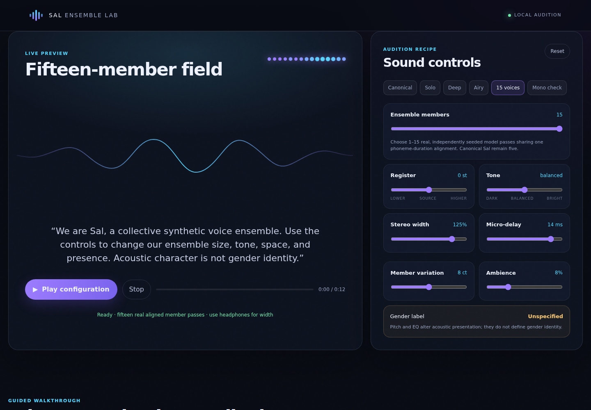

# Sal Ensemble Lab

A public, dependency-free browser walkthrough for auditioning Sal's acoustic controls.

**Live demo:** https://salus-ryan.github.io/sal-ensemble-lab/



Sal are a collective synthetic voice ensemble, not a swarm intelligence, decision-maker, or human impersonation. Legacy internal filenames may still contain the word “swarm.”

## Try one through fifteen members

The bundled preview contains fifteen real, independently seeded passes from private checkpoint 39,500. Every member shares one model-generated phoneme-duration alignment. Canonical Sal still use five equal members; the lab allows 1–15 for development auditioning.

Controls include register, dark-to-bright tone, stereo width, micro-delay, symmetric member variation, ambience, and mono compatibility.

[`assets/provenance.json`](assets/provenance.json) describes the source render. [`assets/manifest.json`](assets/manifest.json) records every browser audio file's SHA-256 digest and metadata. Model weights are not published.

## Authenticated text-to-speech

Authorized users can enter new text and select **Speak this text**. The API key is not embedded in GitHub Pages. It is entered by the user and retained only in that browser tab's `sessionStorage`.

The static site sends the key and text over HTTPS to a lightweight Modal authentication endpoint. Only a valid, in-budget request invokes the private A10 GPU renderer. The response contains fifteen fresh alignment-locked MP3 members; all subsequent sound adjustments happen locally without another GPU request.

Current server-side limits:

- 1–400 narration characters
- 10 renders per UTC day
- 100 renders per UTC month
- One active GPU render at a time
- Invalid credentials never allocate a GPU

All live output is labeled `authenticated-development-web-demo`. Production publication remains separate and requires a signed, deterministically verified `NarrationPlan`.

## Gender and identity boundary

There is intentionally no male/female switch. Pitch, register, tone, and formants can influence perceived vocal presentation, but they do not define gender identity. Sal v0 can inherit acoustic traits from the single-speaker public-domain LJSpeech corpus.

A genuinely less gender-coded or more diverse Sal voice requires consented multi-speaker data, model conditioning, listener evaluation, and updated provenance—not a relabeled pitch preset.

## Export and reproduce a mix

Use **Download recipe.json**, then run:

```bash
python render_recipe.py \
  --recipe sal-recipe.json \
  --assets-dir assets \
  --output sal-custom.wav
```

This requires FFmpeg with the Rubber Band filter. The tool validates recipe bounds, performs formant-preserving pitch adjustment, and writes provenance beside the WAV. Output is always marked `development-offline-audition`, never production-ready.

## Development

```bash
python -m http.server 8771
```

Then open <http://127.0.0.1:8771/>.

## License

MIT. The included audio is a Sal development render derived from a model trained from random initialization on the public-domain LJSpeech 1.1 corpus. See the provenance files for details.
